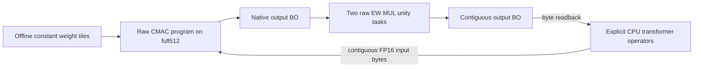

# TinyStories-260K before framework integration

The application priority is now the smallest published checkpoint in the
inspected Karpathy model series: `stories260K.bin` with `tok512.bin`.
General tinygrad integration follows this application milestone. The user
asked us to choose the design and inspect the other local accelerator projects.

The first inference target uses every learned dense projection on the full
C32/K16 FPGA datapath. Embedding lookup, RMSNorm, RoPE, attention, SwiGLU,
residual updates, KV storage and greedy sampling execute as explicit host model
operators. A dense failure stops inference. CPU dense fallback, runtime CPU
gathers and arithmetic/layout repairs in the FPGA path remain forbidden.

This is a design and preparation result. **No RKNPU TinyStories FPGA inference
has run.** The earlier autonomous full512 and USER2 EW hardware results retain
their original scope.

## Current evidence

| Gate | Actual evidence | Remaining work |
|---|---|---|
| Exact model/tokenizer | Two local copies agree with pinned SHA256; five layers, dim64, hidden172, eight query/four KV heads, vocab/context512 | Keep those original logical dimensions and model semantics |
| Official reference | Fresh unmodified `llama2.c`, greedy32 steps, seed1: CPU generation passed | CPU reference is a test target, not hardware execution |
| Static device layout | All36 learned projections prepared as116 OC32 tiles; 557,056 packed weight bytes | No live FPGA model upload yet |
| Preparation controls | Six portable unit methods and eleven actual copied-package/tampering controls pass | Future program/image controls stay separate |
| Finite output movement | Unchanged EW ALU passes all63,488 finite FP16 words times1 in both operand orders under both simulators:253,952 comparisons, with backpressure and signed-zero negative controls | Validate complete raw-command compaction and its memory ownership |
| First trained projection tile | BOS token1, layer0 Wq outputs0..31; original final writer emits49 unchanged QWORDs. Frozen full512 RTL passes Icarus normal/reset-replay/fault modes, with2,176 operand reads and32 acknowledged writes | Verilator/physical projection, complete projections and full model remain unproven |
| Live application | Shared-memory CMAC/EW/USER2 integration is not implemented | Fresh implementation/timing/image review, then a physical projection, one full forward position and full generation |

The first CPU continuation is:

> Once upon a time, there was a little girl named Lily. She loved to play outside in the park. One

The official C runner does not record token IDs; matching text must not be
reported as an independent token-ID or logit comparison. Its model data is
FP32. Our candidate dense contract uses FP16 operands/output and the selected
donor accumulator, so same-policy numerical verification and a separate FP32
comparison are required before accepting generated text.

The [fresh CPU receipt](../build/tinystories-cpu-reference/20261026T180701Z/report.json)
is bound to the first frozen input package. The
[current static package](../build/tinystories-preparation/260k-first-v2/report.json)
adds stronger metadata verification; it retains identical model/weight bytes.
Its [eleven controls](../build/tinystories-package-controls-v2.json) include
isolated-source verification and rejection of altered tile shape, compaction,
addresses, classifier alias, memory contract and weight data.
The [finite unity proof](../build/tinystories-unity/20261026T181010Z/report.json)
and [first trained-tile replay](../build/tinystories-first-projection/bos-wq-native-iverilog-v1/report.json)
have separate source/binary/command/log bindings. The first fixture attempt
found NumPy unavailable; the successful preparation instead calls the exact
official C RMSNorm through its existing `TESTING` interface, without changing
its source or reordering normalization arithmetic.

A [separate first-tile measurement](../build/tinystories-first-projection/bos-wq-fp32-drift/report.json)
compares its32 donor-policy FP16 outputs with the original C FP32 projection:
maximum absolute difference0.00148535 and RMS difference0.000440246. This is
cross-precision data for one tile, not full-model/logit quality or an acceptance
tolerance. The native RTL still must match its same-policy expectations exactly.

The fresh broader [full Make regression](../build/production-tinystories-controls/20261026T182707Z/report.json)
hit the unchanged600-second Icarus host SUB(9) timeout. Its53 host controls,
six new preparation controls and the other completed suites are preserved;
the full invocation remains failed. A separate replay retains the exact
binary, source, stimuli,3219-command expectation and1600-line BO comparison,
with a separate1800-second outer observation bound. It changes no production
deadline or numerical/error expectation and cannot turn the original Make
receipt into a pass.

## Model and static memory contract

The checkpoint SHA256 is
`b0a507e7ad0f626624f17112325e66691f9076d622e1d3274d103d00299f2696`
(1,056,540 bytes); the tokenizer is
`037cb335abb25d1fa9e8ecae30ed2a3a8ace9302862ebcdc05d51a6bbb10c312`
(6,227 bytes). Sources are pinned to
[tinyllamas `0bd21da`](https://huggingface.co/karpathy/tinyllamas/tree/0bd21da7698eaf29a0d7de3992de8a46ef624add/stories260K)
and [llama2.c `350e04f`](https://github.com/karpathy/llama2.c/tree/350e04fe35433e6d2941dce5a1f53308f87058eb).
The unique learned parameter count is260,032. Stored RoPE tables account for
the remaining4,096 FP32 values in the file; the output classifier shares
embedding weights. The prepared input checker rejects a changed checkpoint,
tokenizer, shape or classifier layout.

Each layer has Wq/Wk/Wv/Wo/W1/W2/W3; the output head is the36th projection.
Tile output channels at32, retaining all16 kernels and32 input lanes. Each
CMAC frame still computes the full512 products. Inputs use64 or192 physical
channels (logical64 or172); static weights use the source-evidenced
OC16/IC32 ordering and zero padding. Each tile has four or twelve frames.
This preserves the model's original head dimensions, RMS epsilon and RoPE
pairing; it does not enlarge or compensate the trained transformer.

All packed learned projection weights total557,056 bytes, fitting within the
existing1MiB BRAM aperture. Full-context FP32 K/V storage is655,360 host bytes.
DDR and PCIe are not required for this first hybrid model, though their
original implementation gates remain in the overall plan.

| Candidate device range | Ownership |
|---|---|
| `0x10000000..0x10000fff` | Contiguous FP16 input and zero physical padding |
| `0x10001000..0x10001fff` | Native CMAC output with its original gaps |
| `0x10002000..0x10002fff` | Contiguous model projection output and private padding |
| `0x10003000..0x10003fff` | Immutable unity constants |
| `0x10010000..0x10097fff` | Prepared immutable weight tiles |
| `0x100e0000..0x100effff` | Complete original final-writer command BO |
| `0x100f0000..0x100f3fff` | Original task BO |

These are preparation addresses, not newly enabled hardware ranges. The
current host EW image cannot execute CMAC. A new explicit host/engine
contract and a new source-bound image are required.

## Runtime movement and raw command boundary

For one native32-output tile, logical halfwords0..15 occupy native0..15 and
logical16..31 occupy native32..47. The host must not gather those values.
The proposed hardware movement uses two existing HALF EW MUL tasks with an
immutable exact-unity operand. Finite multiplication by1 preserves every
input bit, including signed zero and subnormals, as the independent RTL proof
checks. Nonfinite inputs are outside this application copy contract; they
must fail explicitly rather than receive CPU repair.

Both CMAC and EW programs pass through the original pinned emitters and
`RockchipProgram._submit_bodies`; their final QWORDs, PC tails, alignment,
guards and descriptors are preserved. The application can select prepared
raw programs, upload contiguous activation bytes and read contiguous results.
It must not add a tensor-operation command to the FPGA transport.



The prepared first-tile report records one successful-standalone reset
callback from the original writer. That callback is not implemented as a
hardware no-op. Integration must first drain every accepted memory response,
then rearm the owned CMAC pipeline/configuration without losing shared RAM
or host completion state. Fault recovery remains explicit and must not use
this success path to clear a fault. Mixed-engine ownership, rearming and
compaction remain unverified.

## Local project references and next acceptance order

| Project checked | Reuse here | Boundary |
|---|---|---|
| `~/ZYNQ-NVDLA` | Same260K assets, five-layer hybrid decomposition, input/output/sentinel checks and per-projection/full-logit audit organization | Its per-row/dynamic INT8 quantization and native DDR/APB interface are different; no numerical or physical result transfers |
| `~/vortex` | Same pinned260K assets, resident weights and a standalone Llama host engine with accelerator matrix dispatch | Its INT8 kernel/ISA and group scales are not the FP16 CMAC contract |
| `~/openTPU` | Static preparation, immutable program readback and source/image-bound JTAG lifecycle | Its inspected model padding changes RMS/RoPE parameters; keep our original model dimensions and do not inherit its quantized ISA or abandoned runtime-clock work |
| `~/etsoc` | Explicit per-layer/output placement and independent CPU/device token/logit checks | Its GGUF is a different artifact, with a different reported parameter count and ET instruction/runtime interfaces |
| `~/KohakuTPU` | Separation of host reference and device execution, model-loading and placement checks | Its first device Llama path requires equal query/KV heads and32-wide head dimensions, unlike this checkpoint |

The read-only [first inventory](../build/tinystories-other-projects-a.json) and
[second inventory](../build/tinystories-other-projects-b.json) retain exact
paths and hashes. TinyTPU, TinyGPU and VeriGPU did not supply a directly
reusable TinyStories runner in the bounded scans. No foreign runner was
executed or foreign image used to claim RKNPU inference.

Proceed in this order:

1. Validate complete raw EW compaction and learned projection numerics.
2. Join full512 CMAC, EW and USER2 with one explicit shared-memory owner and
   success/fault/rearm contract. Retain all512 products and50MHz timing.
3. Qualify new source in both simulators; run a fresh Vivado implementation
   and exact-image/startup/CDC/electrical review. Old checkpoints cannot
   qualify changed RTL.
4. Execute one learned projection on the card with complete output/sentinel
   readback, then one full forward position across all five layers and the
   output head.
5. Generate a short greedy continuation, then the32-position reference
   workload. Compare every dense output and full logits with an independent
   same-policy reference, record token IDs and separately quantify FP32 drift.
6. Return to general tinygrad integration, broader raw-command profiles,
   DDR/PCIe and RK differential qualification. Those gates are not waived.

Preparation and source controls are available without hardware:

```sh
python3 tools/tinystories/prepare.py --model /path/stories260K.bin \
  --tokenizer /path/tok512.bin --llama2c /path/llama2.c --out build/new-260k
python3 -m tools.tinystories.check_package --package build/new-260k \
  --out build/new-260k-controls.json
make tinystories-preparation-test
make tinystories-unity-check
```

The package contains an unchanged licensed C reference, the pinned input
copies and the prepared constant tiles. No command above programs an FPGA,
uses a hardware fallback or establishes whole-model inference.
